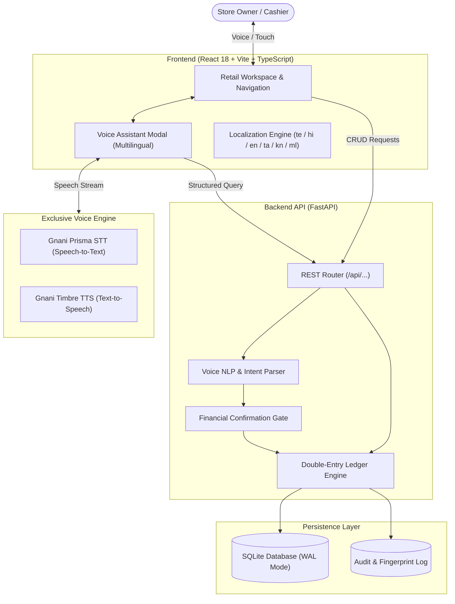
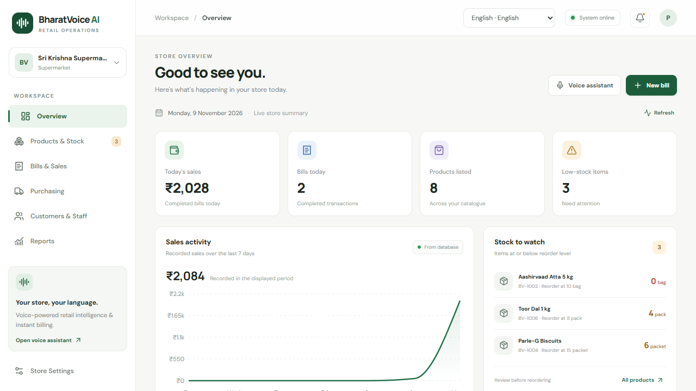
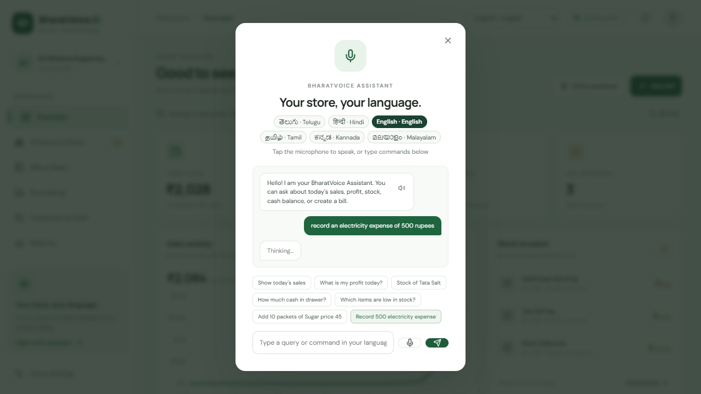
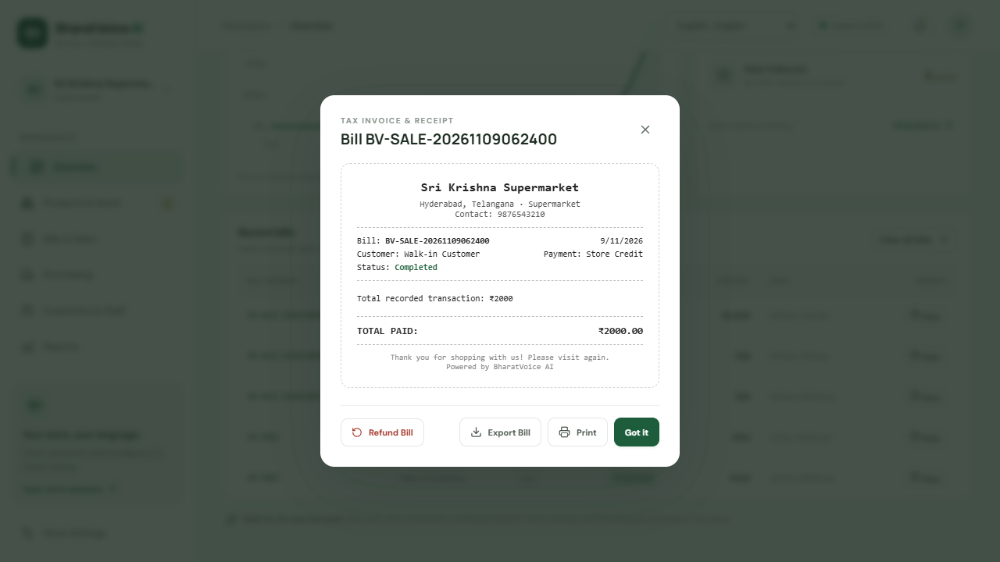

# BharatVoice AI

[](LICENSE)
[](https://www.python.org/)
[](https://fastapi.tiangolo.com/)
[](https://react.dev/)
[]()
[](https://gnani.ai)

> **Voice-First Retail Intelligence & Point-of-Sale System for Indian Store Owners.**  
> Built for small retail businesses, supermarkets, and kirana stores with native multilingual Indic speech recognition, double-entry financial accounting, and safety-guarded voice commands.  
> **All voice input and output is exclusively powered by [Gnani.ai](https://gnani.ai) (Gnani Prisma STT & Gnani Timbre TTS).**

---

## 📌 Table of Contents
- [Overview](#-overview)
- [Problem Statement](#-problem-statement)
- [Project Objectives](#-project-objectives)
- [Key Features](#-key-features)
- [Exclusive Gnani.ai Voice Engine](#-exclusive-gnanai-voice-engine)
- [Technologies & Tools Used](#-technologies--tools-used)
- [System Architecture](#-system-architecture)
- [Repository Structure](#-repository-structure)
- [Screenshots & Demo](#-screenshots--demo)
- [Installation & Setup](#-installation--setup)
- [Running the Application](#-running-the-application)
- [Usage Instructions & Voice Queries](#-usage-instructions--voice-queries)
- [Running the Test Suite](#-running-the-test-suite)
- [Future Enhancements](#-future-enhancements)
- [License](#-license)

---

## 📖 Overview

**BharatVoice AI** is an intelligent, voice-first retail management, Point-of-Sale (POS), and assistive technology platform designed to bridge the digital divide for retail shopkeepers across India. Powered exclusively by **Gnani.ai's** neural Indic voice stack alongside strict double-entry ledger mechanics, BharatVoice AI enables store owners—including differently-abled, visually impaired, and elderly merchants—to operate their business completely hands-free. By speaking naturally in their mother tongue (Telugu, Hindi, Indian English, Tamil, Kannada, or Malayalam), shopkeepers can check inventory, calculate gross and net profits, generate itemized tax receipts, and record expenses safely without keyboard or mouse dependency.

---

## ⚠️ Problem Statement

Traditional enterprise retail software and modern POS tools present steep barriers for independent store owners in India:
1. **Severe Exclusion of Differently-Abled & Elderly Merchants:** Conventional POS and billing software strictly mandate visual inspection, manual keyboard typing, and precise mouse/touchscreen interactions. Store owners with physical disabilities, visual impairments, tremors, arthritis, or limited motor dexterity are systematically excluded from managing their own billing and inventory, making them vulnerable to financial dependence or exploitation.
2. **Language Barriers:** Most commercial retail software is strictly English-first, ignoring native regional languages spoken daily by shopkeepers in non-metro and rural belts.
3. **Counter Speed & Keyboard Friction:** In crowded neighborhood kiranas and busy supermarkets, typing item names and finding buttons creates long queues and operational fatigue.
4. **Financial Vulnerability in Voice Systems:** Generic voice-to-action tools lack safety checkpoints; an unintended utterance or misrecognized number could trigger destructive balance transfers, ledger corruptions, or incorrect cash drawer settlements.
5. **Cloud Brittleness:** Many cloud-only platforms crash or freeze when suburban and rural connectivity drops, paralyzing checkout lines.

---

## 🎯 Project Objectives

- **Empower Differently-Abled & Motor-Impaired Store Owners:** Transform retail billing into an accessible, hands-free experience so individuals with visual, physical, or motor disabilities can run their businesses with dignity and full operational autonomy.
- **Democratize Retail Technology Through Indic Voice:** Provide an intuitive voice interface where shopkeepers speak comfortably in their native language (Telugu, Hindi, Tamil, Kannada, Malayalam, English).
- **Enforce Financial Integrity:** Implement strict double-entry ledger mechanics where every transaction maintains debit/credit parity and generates tamper-evident audit trails.
- **Guarantee Action Safety:** Introduce a **Financial Safety Confirmation Gate** that catches balance-altering operations and requires explicit voice or button verification before ledger commitment.
- **Exclusively Integrate Indic AI Voice:** Standardize 100% of speech recognition and voice synthesis on **Gnani.ai (Prisma STT & Timbre TTS)**, removing third-party or browser-fallback dependencies.

---

## ✨ Key Features

- **♿ Inclusive Assistive Technology for Differently-Abled Retailers:** Voice-in and voice-out bidirectional feedback allows visually impaired, motor-disabled, and elderly shopkeepers to manage store operations hands-free and eyes-free with 100% voice clarity.
- **🗣️ Exclusive Gnani.ai Indic Voice Engine:** 100% powered by Gnani Prisma STT for speech transcription and Gnani Timbre TTS for natural Indic speech synthesis across Telugu, Hindi, Indian English, Tamil, Kannada, and Malayalam.
- **🛡️ Financial Safety Confirmation Gate:** Any spoken or typed command altering finances (e.g., *"Record electricity expense of 500 rupees"*) is caught by an amber confirmation gate, preventing unapproved ledger mutations.
- **📊 Real-Time Central Dashboard:** Tracks Today's Sales, Completed Transactions, Products Listed, and Low-Stock Warnings alongside a 7-day sales velocity AreaChart.
- **🧾 Point-of-Sale (POS) & Tax Invoicing:** Creates sequential bill records (`BV-SALE-...`), generates itemized tax receipts, and exports financial spreadsheets to CSV.
- **📦 Inventory & Real-Time Stock Search:** Complete catalog management with real-time substring filtering, stock level indicators, and reorder alerts.
- **🏪 Dynamic Store Personalization:** Configurable owner profiles, phone numbers, tax/GSTIN credentials, and store rebranding across all views.
- **🧪 Comprehensive Test Coverage:** 119 unit and integration tests covering API routes, duplicate detection, fault injection, and financial consistency.

---

## 🎙️ Exclusive Gnani.ai Voice Engine

BharatVoice AI eliminates all generic or browser-based speech synthesis in favor of an **exclusive integration with Gnani.ai's conversational AI platform**:

```
+-----------------------------------------------------------------------------+
|                          Gnani.ai Voice Stack                               |
+-----------------------------------------------------------------------------+
| 1. Speech-to-Text (STT):                                                    |
|    - HTML5 MediaRecorder captures raw shopkeeper audio (16-bit 48 kHz WAV)  |
|    - Sent to backend `/api/voice/transcribe`                                |
|    - Processed by Gnani Prisma STT (vachana.ai API endpoint)                 |
|    - Handles mixed Indian vocabulary, retailer slang, and accent shifts     |
|                                                                             |
| 2. Text-to-Speech (TTS):                                                    |
|    - Intent response synthesized by Gnani Timbre TTS                        |
|    - Generated via backend `/api/voice/process` & `/api/voice/tts`           |
|    - High-fidelity 48 kHz linear PCM WAV encoded to base64 audio stream     |
|    - Decoded and played directly in browser via HTML5 Audio API             |
|                                                                             |
| 3. Supported Indic Languages:                                               |
|    - Telugu (te-IN - తెలుగు)                                                |
|    - Hindi (hi-IN - हिन्दी)                                                 |
|    - Indian English (en-IN)                                                 |
|    - Tamil (ta-IN - தமிழ்)                                                  |
|    - Kannada (kn-IN - ಕನ್ನಡ)                                                |
|    - Malayalam (ml-IN - മലയാളം)                                             |
+-----------------------------------------------------------------------------+
```

---

## 💻 Technologies & Tools Used

### Backend
- **Framework:** [FastAPI](https://fastapi.tiangolo.com/) (Python 3.11+)
- **Server:** [Uvicorn](https://www.uvicorn.org/) (ASGI high-concurrency server)
- **ORM & Database:** [SQLAlchemy 2.0](https://www.sqlalchemy.org/) with SQLite (WAL mode)
- **Validation:** [Pydantic v2](https://docs.pydantic.dev/)
- **HTTP Client:** [HTTPX](https://www.python-httpx.org/)
- **Voice Services:** [Gnani.ai](https://gnani.ai/) Prisma STT & Timbre TTS REST APIs (Exclusive Voice AI Engine)
- **Testing:** [pytest](https://docs.pytest.org/) & `pytest-asyncio`

### Frontend
- **Framework:** [React 18](https://react.dev/) + [TypeScript](https://www.typescriptlang.org/)
- **Build Tool:** [Vite](https://vitejs.dev/)
- **Charts:** [Recharts](https://recharts.org/) (Responsive Area Charts)
- **Icons:** [Lucide React](https://lucide.dev/)
- **Styling:** Modular Responsive CSS with theme variables and accessibility cues

---

## 🏛️ System Architecture



---

## 📂 Repository Structure

```
BharatVoiceAI/
├── backend/                        # FastAPI Python backend
│   ├── app/                        # Application source code
│   │   ├── accounts_service.py     # Cash drawer and settlement management
│   │   ├── auth.py                 # Multi-store API key authorization
│   │   ├── bill_import_service.py  # Bulk bill ingestion and duplicate detection
│   │   ├── database.py             # Database engine and sessionmaker
│   │   ├── finance_service.py      # Double-entry ledger and P&L calculations
│   │   ├── gnani_service.py        # Gnani AI Prisma STT & Timbre TTS integration
│   │   ├── main.py                 # FastAPI application routes and startup logic
│   │   ├── migrations.py           # Database migration runner
│   │   ├── models.py               # SQLAlchemy ORM models
│   │   ├── schemas.py              # Pydantic request and response schemas
│   │   ├── seed.py                 # Initial catalog and sales seed data
│   │   └── voice_service.py        # NLP entity extraction and intent mapping
│   ├── tests/                      # Pytest automated test suite (119 tests)
│   ├── .env.example                # Backend environment configuration template
│   ├── OPERATIONS.md               # Backend operational playbook
│   └── requirements.txt            # Python dependencies
├── docs/                           # Documentation and visual architecture
│   ├── architecture.md             # Detailed engineering design specifications
│   └── screenshots/                # Application interface screenshots
├── frontend/                       # React 18 + TypeScript frontend
│   ├── src/                        # UI source components
│   │   ├── App.tsx                 # Main application dashboard and tabs
│   │   ├── Onboarding.tsx          # Store setup and onboarding wizard
│   │   ├── i18n.tsx                # Multilingual translations and state
│   │   ├── api.ts                  # Typed API client
│   │   ├── types.ts                # Domain TypeScript interfaces
│   │   ├── onboarding.css          # Onboarding layout styling
│   │   └── styles.css              # Main workspace stylesheet
│   ├── .env.example                # Frontend environment configuration template
│   ├── package.json                # Node.js dependencies
│   ├── tsconfig.json               # TypeScript configuration
│   └── vite.config.ts              # Vite bundler configuration
├── .env.example                    # Root environment configuration template
├── .gitignore                      # Git exclusion rules (secrets, caches, builds)
├── CONTRIBUTING.md                 # Contribution guidelines
├── LICENSE                         # MIT License
├── pytest.ini                      # Pytest discovery configuration
├── README.md                       # Repository overview and documentation
├── requirements.txt                # Root Python dependencies manifest
├── start-backend.bat               # Windows backend startup script
├── start-backend.sh                # Unix / Linux / macOS backend startup script
├── start-frontend.bat              # Windows frontend startup script
└── start-frontend.sh               # Unix / Linux / macOS frontend startup script
```

---

## 📸 Screenshots & Demo

### 1. Centralized Retail Dashboard

*Real-time KPIs (Today's Sales, Completed Bills, Listed Products, Stock Alerts) and 7-day sales velocity chart.*

### 2. Multilingual Voice Assistant & Financial Safety Gate

*Voice assistant in Telugu (`తెలుగు`) with the Financial Safety Confirmation Gate intercepting financial operations.*

### 3. Products Catalog & Itemized Tax Invoicing

*Itemized tax invoice receipt modal with export bill (TXT), print, and CSV spreadsheet download capabilities.*

---

## 🚀 Installation & Setup

### Prerequisites
- **Python 3.10+** (Python 3.11 recommended)
- **Node.js 18+** and **npm 9+**
- **Git**

### 1. Clone the Repository
```bash
git clone https://github.com/itzPardhiv/BharatVoiceAI.git
cd BharatVoiceAI
```

### 2. Backend Setup
```bash
# Create and activate a Python virtual environment
python -m venv .venv

# On Windows:
.venv\Scripts\activate
# On Linux / macOS:
source .venv/bin/activate

# Install dependencies
pip install -r requirements.txt

# Configure environment variables
cp .env.example .env
```

> [!TIP]
> Add your `GNANI_API_KEY` and `GNANI_ACCESS_KEY` to `.env` to activate live neural voice transcription (Gnani Prisma STT) and voice synthesis (Gnani Timbre TTS).

### 3. Frontend Setup
```bash
cd frontend
npm install
cp .env.example .env
cd ..
```

---

## 🖥️ Running the Application

### Automated Startup

**Windows:**
- Double-click `start-backend.bat` (Starts FastAPI on `http://127.0.0.1:8000`)
- Double-click `start-frontend.bat` (Starts Vite on `http://localhost:5173`)

**Linux / macOS:**
```bash
chmod +x start-backend.sh start-frontend.sh
./start-backend.sh &
./start-frontend.sh
```

### Manual Startup

**Terminal 1 (Backend):**
```bash
python -m uvicorn app.main:app --app-dir backend --reload --port 8000
```
- API Base URL: `http://127.0.0.1:8000`
- Interactive Swagger Documentation: `http://127.0.0.1:8000/docs`

**Terminal 2 (Frontend):**
```bash
cd frontend
npm run dev
```
- Web Application: `http://localhost:5173`

---

## 💬 Usage Instructions & Voice Queries

Once the application is running, open `http://localhost:5173` in your browser. Complete the initial 4-step onboarding or launch the **Voice Assistant** directly from the top-right header:

### Sample Spoken Commands:
| Language | Spoken / Typed Query | Meaning / Action Triggered |
|---|---|---|
| **Telugu (`te`)** | *"ఈ రోజు అమ్మకాలు ఎంత?"* | Queries today's gross sales and returns spoken Telugu audio. |
| **Telugu (`te`)** | *"టాటా సాల్ట్ స్టాక్ ఎంత?"* | Looks up current stock quantity for Tata Salt. |
| **Hindi (`hi`)** | *"आज की बिक्री कितनी है?"* | Returns today's sales and completed bill count in Hindi. |
| **Hindi (`hi`)** | *"कम स्टॉक वाले आइटम"* | Lists all products currently below their reorder threshold. |
| **English (`en`)** | *"Record an electricity expense of 500 rupees"* | Triggers the **Financial Safety Gate**; prompts user confirmation before committing. |
| **English (`en`)** | *"Add 10 packets of Sugar price 45"* | Creates an inventory addition bill and updates stock levels. |

---

## 🧪 Running the Test Suite

The backend contains 119 automated unit, integration, and fault-injection tests validating API routes, double-entry ledgers, and NLP intent parsing:

```bash
# Run pytest directly from repository root
pytest

# Run with verbose output
pytest -v
```

**Test Suite Coverage:**
- `test_advanced_features.py` (Advanced multi-item queries and ledger adjustments)
- `test_api_endpoints.py` (REST contract testing across products, bills, summary)
- `test_bill_parser.py` (Receipt parsing and line-item extraction)
- `test_database_models.py` (SQLAlchemy schema constraints and foreign keys)
- `test_duplicate_detection.py` (Tamper-evident fingerprint and double-billing guards)
- `test_e2e_and_fault_injection.py` (Database disconnections and simulated network timeouts)
- `test_financial_integrity_and_acceptance.py` (Debit/Credit ledger balance validation)
- `test_migrations.py` (Schema migration resilience)
- `test_retail_and_voice.py` (Multilingual intent and entity mapping)

---

## 🔮 Future Enhancements

- [ ] **WhatsApp Invoice Sharing:** Automated PDF receipt delivery via WhatsApp Cloud API.
- [ ] **Offline Barcode Scanner Integration:** Camera-based barcode and QR scanning for fast checkout.
- [ ] **Direct UPI Dynamic Soundbox:** Audio confirmation webhook on real-time UPI payment settlement.
- [ ] **Federated Sync:** Multi-store data synchronization between cloud PostgreSQL and local edge nodes.

---

## 📄 License

This project is licensed under the [MIT License](LICENSE).
