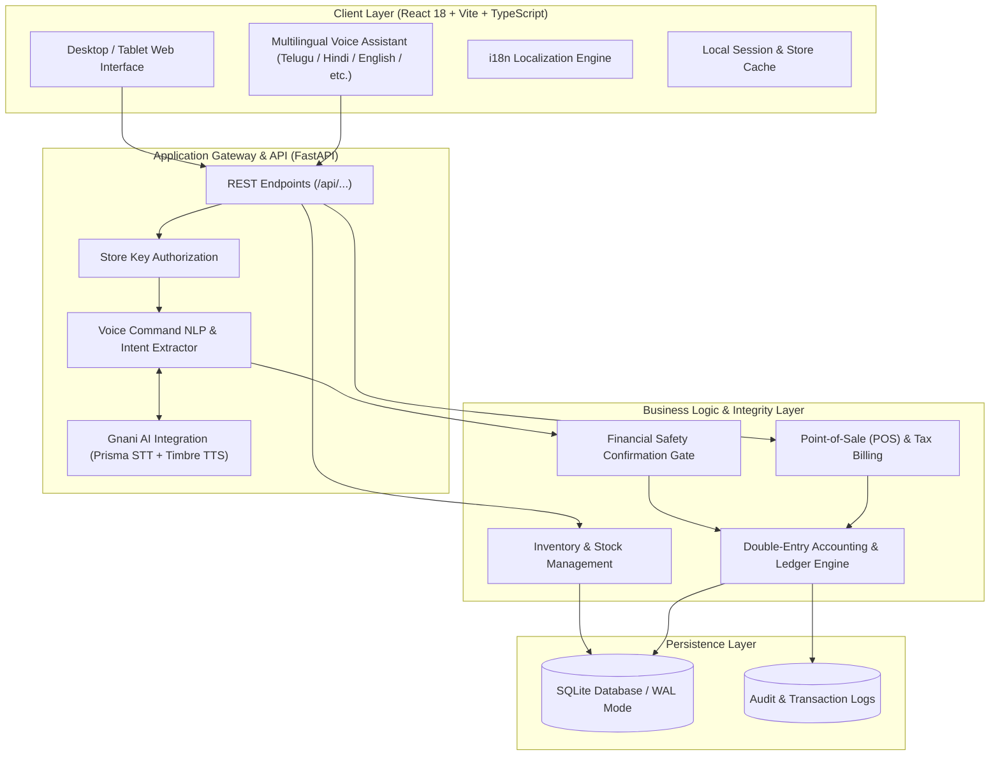

# BharatVoice AI — System Architecture & Engineering Design

This document details the architectural decisions, database schemas, financial ledger principles, and voice NLP pipeline powering **BharatVoice AI**.

---

## 🏛️ High-Level System Architecture

---

## 🎙️ Multilingual Voice Engine (Gnani AI Exclusive)

BharatVoice AI implements an exclusive Indic voice architecture powered by **Gnani.ai**:

1. **Audio Capture & Streaming:**
   - HTML5 `MediaRecorder` audio capture (16-bit 48 kHz PCM / WAV container) streaming directly to **Gnani Prisma STT** (`/api/voice/transcribe`) for high-accuracy Indic speech recognition.
2. **Intent Parsing & Entity Extraction (`backend/app/voice_service.py`):**
   - Natural language queries in Telugu, Hindi, Indian English, Tamil, Kannada, and Malayalam are parsed for retail intents:
     - `CHECK_SALES` (*"ఈ రోజు అమ్మకాలు ఎంత?"* / *"Today's sales"*)
     - `CHECK_STOCK` (*"టాటా సాల్ట్ స్టాక్ ఎంత?"* / *"Stock of Tata Salt"*)
     - `CREATE_BILL` (*"2 packets of milk"* / *"Add 5 kg rice"*)
     - `RECORD_EXPENSE` (*"Record electricity bill of 500 rupees"*)
3. **Financial Safety Gate (`backend/app/main.py`):**
   - Financial mutations (recording expenses, modifying prices, voiding sales) are intercepted by a confirmation state gate:
   - Returns `action_required: true` and an `action_payload`.
   - The user must explicitly inspect and confirm the action before it commits to the ledger.
4. **Speech Response Generation (`backend/app/gnani_service.py`):**
   - Assistant voice responses are synthesized via **Gnani Timbre TTS** (`/api/voice/process` & `/api/voice/tts`) in the store owner's native language (e.g. `te-IN`, `hi-IN`, `en-IN`), returning 48 kHz audio WAV streams played directly in the client.

---

## 💰 Double-Entry Ledger & Accounting Mechanics

To guarantee financial consistency for small retailers, every financial transaction records balancing debit and credit entries:

- **Sale Transaction:**
  - `Debit`: Cash Drawer / UPI Settlement Account
  - `Credit`: Sales Revenue Account
- **Cost of Goods Sold (COGS):**
  - `Debit`: COGS Account
  - `Credit`: Inventory Asset Account
- **Store Expense:**
  - `Debit`: Operating Expense Account (e.g., Electricity, Rent)
  - `Credit`: Cash Drawer / Bank Account

Every commit runs inside an atomic SQLAlchemy transaction block with rollbacks on integrity violations.

---

## 📦 Database Schema Overview

- **`StoreProfile`**: Registered store name, owner name, mobile, address, preferred language.
- **`Product`**: SKU, name, category, stock quantity, cost price, selling price, unit, reorder level.
- **`Sale` & `SaleItem`**: Bill sequence number, customer name, total amount, payment method, tax rate, itemized quantities and rates.
- **`LedgerEntry`**: Double-entry ledger journal lines with account codes, debit/credit values, timestamps, and reference IDs.
- **`AuditLog`**: Hash-fingerprinted tamper-evident audit record for every write operation.

